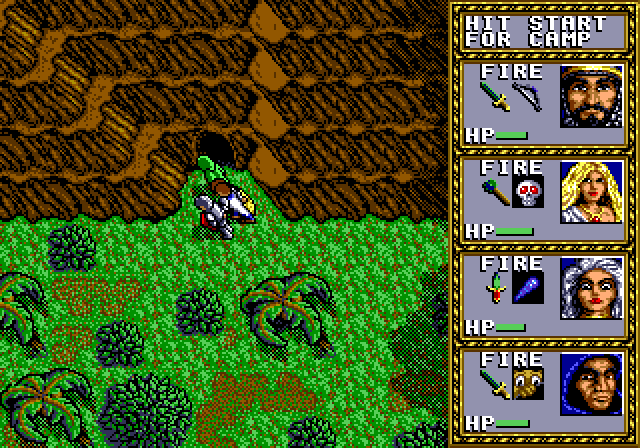
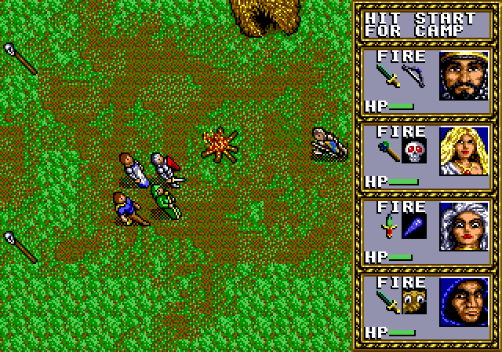
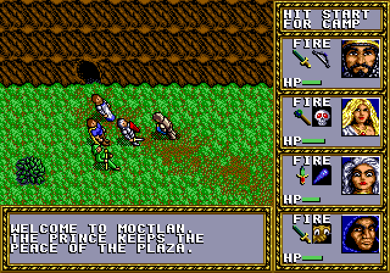
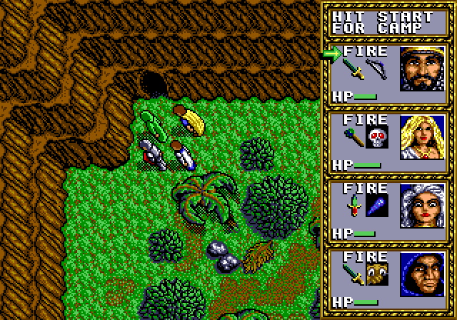
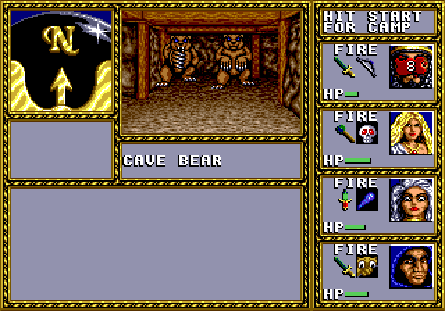

# Oltec Hills patch for Warriors of the Eternal Sun

A patch for Dungeons & Dragons: Warriors of the Eternal Sun on the Sega Genesis and Mega Drive. It gives the game a fourth outdoor region, the Oltec Hills, true to the Hollow World book: the Oltec Tradeway dungeon no longer ends at its foot but opens on the hills, with places and people of their own, caves and a dungeon behind them, a map screen, and the meeting with the Oltec merchant moved there from the dungeon's foot.

 <br>
 <br>


## Playing it

1. Get the patch from the [releases](https://github.com/levonn-dev/wotes-oltec/releases): `oltec.bps` for the original game, `oltec-chili-v1.bps` or `oltec-chili-v2.bps` for a ROM that already carries V1.0 or V2.0 of [planetchili's patch](https://github.com/planetchili/wotes_patch), which fixes the game's logic bugs and rebalances its classes. `sha1sums.txt` lists the three files' SHA-1 sums.
2. Apply it to your ROM, `Dungeons & Dragons - Warriors of the Eternal Sun (USA, Europe).md` with SHA-1 `9135f7fda03ef7da92dfade9c0df75808214f693` (for the Chili files, that ROM with planetchili's patch applied), with a BPS patcher such as [Flips](https://github.com/Alcaro/Flips) or [mdrom](https://github.com/levonn-dev/mdrom): `mdrom bps apply --base rom.md --patch oltec.bps --out oltec.md`. A BPS file carries the checksum of the ROM it expects, so a patcher warns of any other. The ROM itself is not distributed here.
3. Play the 2 MB result in an emulator or flash cart. The patch keeps the game's save format.

## Status

- [x] Build flow: cross-compiled with GCC, injected into a 2 MB image with mdrom, shipped as a BPS patch, with 68000-instruction and hook checks in the build.
- [x] Reverse engineering: the region loader and its tables, the save format, the dungeon transitions and the world map, named as linker symbols in `game/`.
- [x] A fourth region reachable in play: region 4, cloned from the jungle, entered and left through the Tradeway's bottom level, saved and loaded as HILLS.
- [x] The region's own identity: an area id, music and an encounter list of its own.
- [x] A Tiled toolchain: every outdoor tile set and map extracted into Tiled with its entrances, places, figures and fixed fights, new maps converted into the engine's tables at build time.
- [x] Objects on a Tiled land map: entrances, shops, speeches, a restore and figures, converted into tables a region reads.
- [x] The dungeon levels in Tiled: all 38 extracted top-down with their walls, entry points, items, monsters, events and stairs, and the tool's knowledge of the ROM in a layout file another project can replace.
- [x] The Oltec Hills themselves, drawn in Tiled from the Hollow World book: the map, the places and the people.
- [x] The caves of the Oltec Hills and the Oltec dungeon behind them, drawn in Tiled as one map that the build turns into the game's own levels.
- [x] The dungeon's second pass: its monsters, treasure and texts.
- [x] The map screen of the Oltec Hills, drawn from the finished land map.
- [x] The merchant meeting moved into the Oltec Hills, with the medallion and the quest picture it grants restored.
- [x] Compatibility with planetchili's patch: builds for the original game and for the V1.0 and V2.0 patches, one BPS each.
- [x] A polishing pass.

## How it works

The patch is 68000 assembly built with the m68k-linux-gnu GCC, injected with [mdrom](https://github.com/levonn-dev/mdrom) into the clean ROM and into the ROM patched with [planetchili's patch](https://github.com/planetchili/wotes_patch), and shipped as a BPS patch for each. The game's three regions all follow one pattern, so the patch extends the engine's own tables and loaders rather than replacing them.

New code lives in the 2 MB expansion, reached through six-byte `jsr` hooks; the game tables the patch extends are spliced out of the base ROM at build time, which is why each build tree keeps a copy of it as `base.md`.

## Prerequisites

To build the patch yourself:

- Ubuntu 24.04, natively or under WSL2 (the emulator window needs WSLg or an X display).
- [Task](https://taskfile.dev/installation/) 3.28 or later.
- Go 1.26 or later. It builds `wotes-tiled`, which turns Tiled maps into the tables the patch links.
- Optional: [Tiled](https://www.mapeditor.org/) 1.12, fetched into `tools/` by `task tiled:install`, or your own install; see `docs/tiled.md`.
- The cross compiler, debugger, and helpers:

  ```
  sudo apt install cmake ninja-build gcc gcc-m68k-linux-gnu gdb-multiarch binutils shellcheck curl unzip
  ```

- The clean ROM, `Dungeons & Dragons - Warriors of the Eternal Sun (USA, Europe).md`, SHA-1 `9135f7fda03ef7da92dfade9c0df75808214f693`. It is not part of the repository, and it is the only ROM to supply: bootstrap fetches [planetchili's patches](https://github.com/planetchili/wotes_patch/releases) and the build applies them to it.

## Quick start

```
git clone https://github.com/levonn-dev/wotes-oltec.git
cd wotes-oltec
task bootstrap
cp /path/to/'Dungeons & Dragons - Warriors of the Eternal Sun (USA, Europe).md' .
task build
```

`task bootstrap` downloads the BlastEm nightly, the mdrom release and planetchili's V1.0 and V2.0 patches into `tools/`, builds `wotes-tiled` there when Go is present, checks the apt tools, and prints the apt line above if one is missing. It writes nothing outside the repository and never uses sudo. A ROM kept elsewhere is named with `task configure -- -DCLEAN_ROM=<path>`; options after `--` reach CMake in every build tree, even when it is already configured.

## Tasks

`task` with no arguments lists them.

| Task | Does |
|---|---|
| `bootstrap` | BlastEm, mdrom and planetchili's two patches into `tools/`, wotes-tiled built there; checks the apt tools and the clean ROM |
| `build` | Configures the three build trees (`build/m68k`, `build/m68k-chili-v1`, `build/m68k-chili-v2`) if needed, extracts `maps/rom/` from the clean ROM when it is missing or stale, then in each tree links, runs the 68000 and hook checks, injects and writes the BPS |
| `run` | The patched ROM in BlastEm; `BASE=chili-v1` or `BASE=chili-v2` runs that build |
| `check` | `build`, the wotes-tiled round trip against the clean ROM, then the scripted GDB check on each of the three ROMs |
| `check:host` | wotes-tiled tests, shellcheck; no cross compiler or ROM needed (what CI runs) |
| `check:target` | The on-target GDB checks alone |
| `debug` | Interactive `gdb-multiarch` against BlastEm, paused at the reset vector; `BASE` as for `run` |
| `tiled:extract` | Every outdoor tile set and map and every dungeon level of the clean ROM into `maps/rom/` as Tiled files; `build` runs it when needed, since the land map paints with those tilesets |
| `tiled:render -- ARGS` | A map or a ROM region to PNG |
| `tiled:install` | Tiled 1.12 into `tools/tiled/` (optional) |
| `tiled -- FILE` | Opens the Tiled project, or a map, in that Tiled |
| `tiled:build`, `tiled:test`, `tiled:roundtrip` | Build the tool into `tools/wotes-tiled`, vet and test it without the ROM, round-trip every ROM region, dungeon level and VIEW MAP picture |
| `configure` | The CMake configure of the three trees alone; extra options after `--` go to each |
| `clean` | Removes `build/` and the Task cache (keeps `tools/`) |

## Outputs

In each build tree, `patch.elf` (the linked patch with DWARF), the 2 MB patched image (`patched.md`, or `patched-chili-v1.md` and `patched-chili-v2.md` in the Chili trees, so that BlastEm keeps each build's saves apart) and `base.md` (the ROM it was built on); and the patch to distribute: `build/m68k/oltec.bps` for the clean ROM, `build/m68k-chili-v1/oltec-chili-v1.bps` and `build/m68k-chili-v2/oltec-chili-v2.bps` for the clean ROM with planetchili's V1.0 or V2.0 patch.

## Releases

A pushed `v*` tag runs `.github/workflows/release.yml` on a GitHub runner: bootstrap, the clean ROM fetched from the `ROM_URL` repository secret and checked against its SHA-1, `task build`, `task check`, then a GitHub release named after the tag, with the annotated tag's message as its notes and the three BPS files and their SHA-1 sums attached. Started from the Actions tab instead, the workflow builds and checks without publishing. The ROM is never stored in the repository, and nothing under `build/` leaves the runner.

## Layout

- `src/`, `hooks/`, `game/`, `link/`: patch code, hook sections, game symbols, linker script
- `cmake/`: the m68k toolchain file, the mdrom lookup and the wotes-tiled build
- `wotes-tiled/`: the Go tool that moves outdoor maps and dungeon levels between the ROM and Tiled (`docs/tiled.md`)
- `maps/`: the land map, the caves and dungeon map, the metatile definitions, the new tiles, the area-map picture and the Tiled project file; `maps/rom/` and `maps/gen/` are generated and not committed
- `scripts/`: bootstrap, the Tiled installer, the BlastEm and GDB launchers, and the build-time and on-target checks
- `docs/`: `debugging.md` for GDB and IDEA, `tiled.md` for drawing maps, `screenshots/` the pictures above at the game's 320×224 and doubled
- `tools/`: created by bootstrap, not committed
- `.github/`: the CI workflow, which runs `task check:host`, the release workflow, and `CODEOWNERS`

## License

The repository's own work, the patch source, the maps, the tools and the documents, is under the MIT license in `LICENSE`. That license covers nothing else:

- Dungeons & Dragons: Warriors of the Eternal Sun, its ROM, and everything the patch takes from them (the tables the build splices out of the ROM, the tiles it redraws from the game's own, and the setting's names and places) belong to their rights holders. The ROM is not distributed here, and the patch ships as a BPS file that needs the player's own copy.
- planetchili's patch is referred to for interoperability only: the build fetches the V1.0 and V2.0 patches from planetchili's own releases to build versions of this patch that apply on top of them, and none of those files are kept in this repository. planetchili's patches and the reverse-engineering work in them remain theirs, under their own terms.
